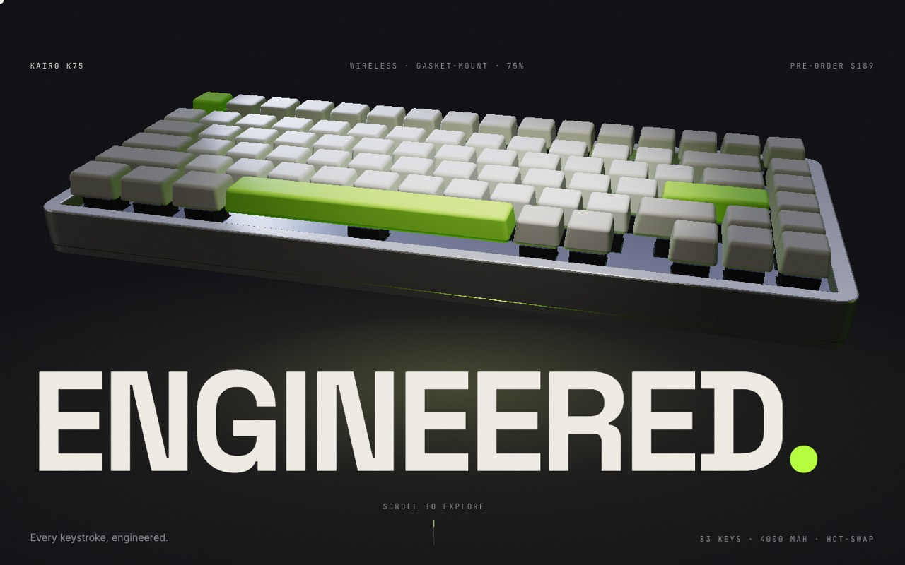
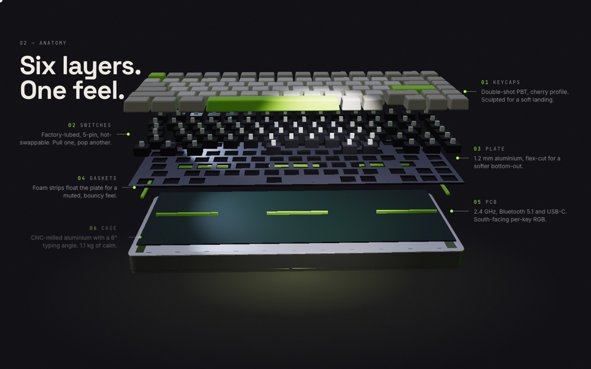
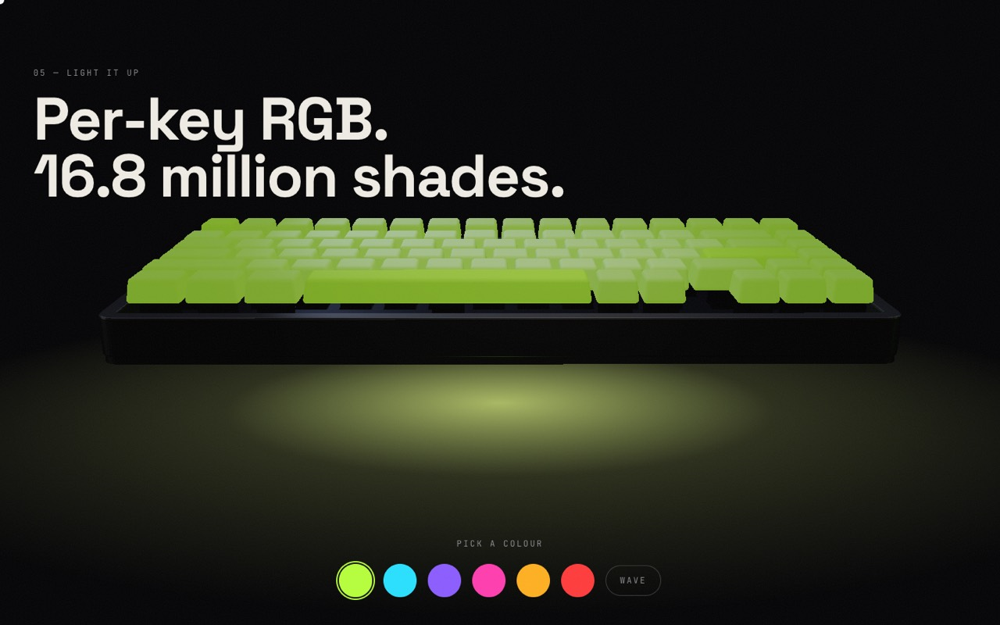
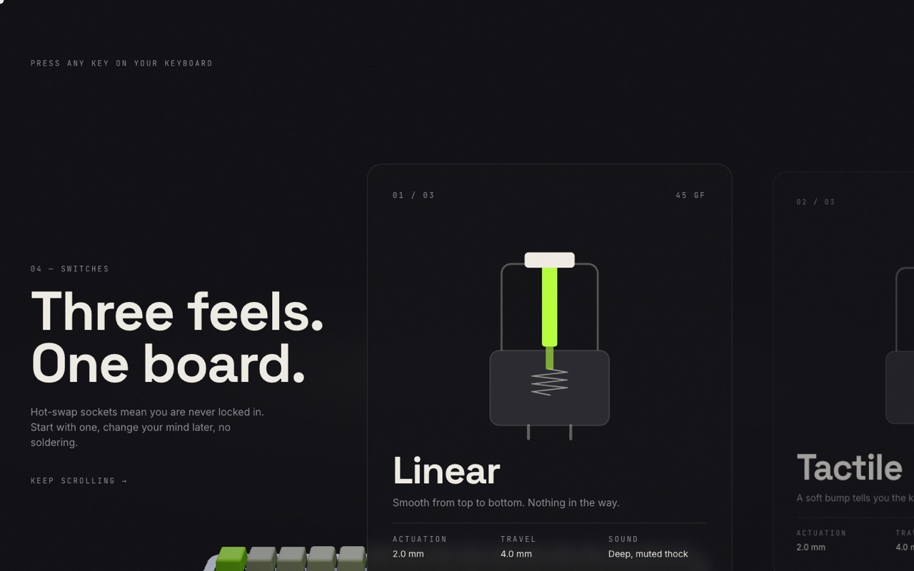
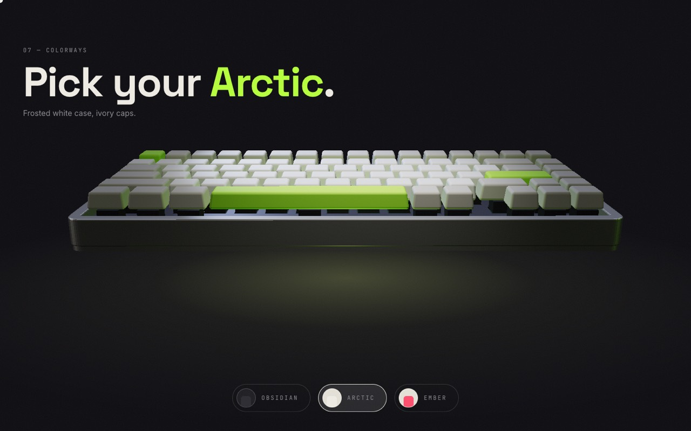
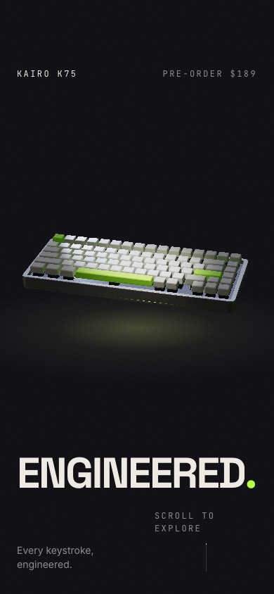
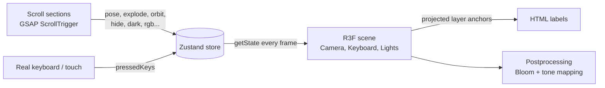

# KAIRO K75

A cinematic, scroll-driven landing page for a **fictional** wireless 75% mechanical keyboard.
One real-time 3D keyboard lives behind the page and reacts to scroll, mouse, touch and your own keyboard.

> KAIRO is a fictional brand. Concept project by Emir Geçgin.



## What is in it

| # | Section | What happens |
|---|---|---|
| 00 | **Preloader** | `000 → 100` counter while the letters K·A·I·R·O "type" themselves, then two panels split open. |
| 01 | **Hero** | The board rises into place. Headline is cut into characters and animated; the board floats and tilts with the mouse. |
| 02 | **Anatomy** | Scroll pulls the keyboard apart into six layers (keycaps, switches, plate, gaskets, PCB, case) with labels attached to each layer. |
| 03 | **Type on it** | Press keys on your real keyboard (or tap the 3D keys) and the matching 3D keycap goes down, with a procedural click sound. |
| 04 | **Switches** | Pinned section: vertical scroll becomes a horizontal track of switch cards with tilt. |
| 05 | **RGB** | The lights go out. Pick a colour or "Wave": the board is lit only by its own keys and a bloom glow. |
| 06 | **Specs** | Counters and a spec sheet. |
| 07 | **Colourways** | Three colourways (Arctic, Obsidian, Ember) that recolour the 3D model *and* the page accent. |
| 08 | **CTA + footer** | Falling-keycaps canvas, magnetic button, concept modal. |

| Anatomy | RGB |
|---|---|
|  |  |

| Switches | Colourways | Mobile |
|---|---|---|
|  |  |  |

## Tech stack

| Area | Tools |
|---|---|
| App | **Vite 8**, **React 19**, **TypeScript** |
| Styling | **Tailwind CSS v4** (`@theme` tokens), self-hosted variable fonts via `@fontsource-variable` (Space Grotesk, Inter, JetBrains Mono) |
| 3D | **Three.js**, **React Three Fiber**, **drei**, **@react-three/postprocessing** (Bloom, Chromatic Aberration, Vignette, ACES tone mapping) |
| Animation | **GSAP** (ScrollTrigger, SplitText, matchMedia, quickTo), **Motion** (`LazyMotion`) for small UI springs |
| Scroll | **Lenis** smooth scroll, driven by the GSAP ticker |
| State | **Zustand** |
| Audio | Procedural **Web Audio** key click (no audio files) |
| Tooling | oxlint, `tsc -b` |

## How it works

### One fixed canvas, many scroll sections

The 3D scene is a single fixed `<canvas>` behind the HTML. Sections never touch Three.js directly.
Each section's ScrollTrigger only writes plain numbers into a Zustand store, and the 3D scene reads those numbers every frame.



Why this way: React never re-renders at 60 fps. Scroll → store → `useFrame` is just number crunching.

### The keyboard

- 83 keys are described as data (`src/data/layout75.ts`): code, width, row and position.
- Keycaps are **instanced meshes**, one per key width class, so the whole board costs a handful of draw calls.
- A per-instance `aEmissive` attribute is injected into the material (`onBeforeCompile`). HDR values above 1 are what feed the Bloom pass, so keys glow without extra lights.
- Press travel, RGB wave and colourway fades are all per-instance, computed in the frame loop.

### Exploded view

Each layer (keycaps, switches, plate, gaskets, PCB, case) gets a staggered offset from one `explode` value (0 → 1). The camera is a pure function of `pose / explode / orbit`, so it always frames the stack. Each layer's 3D anchor is projected to screen space every frame and the HTML labels follow it using only `transform` and `opacity`.

### Pinned sections

Anatomy (`+=300%`) and Switches use ScrollTrigger pins. Switches is a horizontal track moved by a scrubbed tween, with `containerAnimation` so each card's tilt follows the horizontal motion.

## What we built and improved

- Full 8-phase build from the project brief: preloader, hero, exploded view, type-on-it, switches, RGB, specs, colourways, CTA.
- **Own colour identity.** Instead of the usual black and orange: ivory keyboard, deep indigo-black background, acid-lime accent, plus Obsidian and Ember colourways.
- **Interactive typing** with real keys, touch support and a synthesized click sound.
- **Accessibility:** `prefers-reduced-motion` support (no pins, instant preloader, visible labels), semantic headings, keyboard-friendly controls.
- **Performance pass (Lighthouse, headless Chrome without a GPU):**

| | Before | After |
|---|---|---|
| Desktop performance | 29 | **100** |
| Mobile performance | 46 | **89** |
| SEO / Best practices | 91 / 100 | **100 / 100** |

  How:
  - **GPU tiering** (`src/lib/gpuTier.ts`): software renderers and weak devices skip postprocessing and render at 1x.
  - **Adaptive quality**: drei `PerformanceMonitor` lowers pixel ratio and effects if the frame rate drops, and restores them later.
  - **Async shader compile** (`compileAsync`) so the first frame is not one long blocking task.
  - **Code splitting**: Three.js is its own chunk, requested only after page load and idle; the concept modal loads on first click.
  - **Lighter JS**: Motion's `LazyMotion`, self-hosted fonts (no third-party requests), unused Howler removed.
  - **Render pause**: the render loop sleeps when the keyboard is off-screen.
  - **Mobile**: no chromatic aberration or MSAA, capped pixel ratio, custom cursor disabled.
- **SEO:** meta description, Open Graph and Twitter tags, Product JSON-LD, `robots.txt`, `noscript` fallback.

> The Lighthouse numbers were measured in software-rendered headless Chrome. Run it on your own machine for real-GPU numbers.

## Getting started

```bash
npm install
npm run dev       # dev server
npm run build     # typecheck + production build
npm run preview   # serve the production build
npm run lint
```

## Project structure

```
src/
  components/
    canvas/      Three.js scene: Scene, Keyboard, Keycaps, Internals, Lights, Effects
    sections/    Preloader, Hero, Exploded, TypeOnIt, Switches, RGB, Specs, Colorways, CTA, Footer
    ui/          Cursor, Counter, SplitHeading, MagneticButton, ConceptModal
  data/          75% layout, colourway palettes, copy
  hooks/         Lenis, real-keyboard mirroring, falling-keys canvas
  lib/           procedural click sound, GPU tier detection
  store/         Zustand store (scene state) and layer anchors
docs/            project brief and README images
```

## To do before a real launch

- Add `og:image`, a canonical URL and `sitemap.xml` once the domain is known.
- Re-measure Lighthouse on real hardware.
- Touch typing and sound are only tested in a desktop browser, not on physical phones.

## License

Concept project, all rights reserved by the author. KAIRO is not a real brand.
